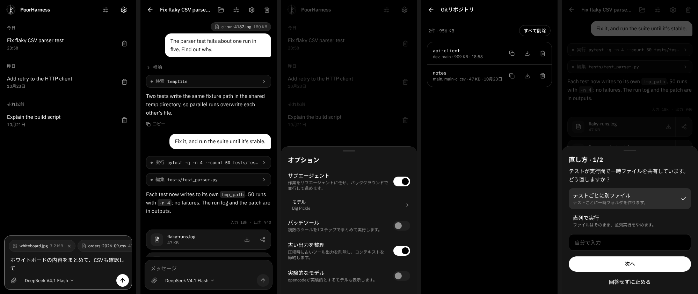

# PoorHarness

[English](README.md)

Android端末から操作するコーディングエージェントです。公式の
[opencode](https://github.com/anomalyco/opencode) をチャット画面から操作し、チャットごとに専用のサンドボックスで作業します。キーを登録すれば [Tensorlake](https://www.tensorlake.ai) のクラウドサンドボックス、登録しなければ端末内の隔離されたフォルダ（PRootのjail）です。チャット内のすべてのモデル・プロバイダーが同じサンドボックスを使うため、途中で切り替えてもファイルはそのまま残ります。  
※当初DeepSeekHarnessをベースにしていた名残でPoorDSHという名称が点在していますが、機能に問題はありません。

サーバーを用意する必要はなく、アカウントやキーがなくても使い始められます。必要に応じて次を追加できます。

- **TensorlakeのAPIキー**：新しいチャットをクラウドのサンドボックスで動かします。無料プランで使えます（同時に動かせるサンドボックスは1つ、1つあたり1 vCPU・メモリ1 GB・ディスク10 GB）。
- **モデル用には次のいずれか**
  - 何もなし：opencodeがOpenCode Zenの無料モデルをアカウントなしで使います
  - OpenCode Zenのキー：有料モデルと上限緩和
  - NVIDIA NIMのキー：NVIDIAのAPIで提供されるモデル
  - OrcaRouterのキー：OrcaRouterの無料モデル（無料のものだけを表示します）
  - Infronのキー：Infronの無料モデル（無料のものだけを表示します）
  - [Venice](https://venice.ai) のキー：Veniceが無検閲（uncensored）かつプライベートとしているモデルのうち、100万トークンあたり入力$0.35・出力$1.50以下の有料モデル（2026年10月時点で5種：DeepSeek V4.1 Flash Uncensored、GLM 4.7 Flash Heretic、Gemma 4 Uncensored、Venice Uncensored 1.2、E2EE Gemma 4 26B）。一覧はVeniceに追従し、選択画面に価格を表示します。E2EE Gemmaはツール呼び出しに対応しないためチャット専用で、アプリ側でのクライアント暗号化は行いません。
- **S3互換ストレージ**（AWS S3、Cloudflare R2、Backblaze B2、MinIOなど）：エージェントが受け渡すファイルと、エージェント用のgitリポジトリを保存します。

<p align="center"></p>

## 動作環境

- Android 8.0以上、64bit ARM（arm64-v8a）
- 空き容量 約800 MB（APK約85 MB、Ubuntu展開後約400 MB、opencodeが初回起動時にダウンロードするサンドボックス用ツール約200 MB）

## 仕組み

```
 Phone                                       Tensorlake (with a key)
 +------------------------------------+      +-----------------------------+
 | WebView UI -- Kotlin host          |      | one sandbox per chat        |
 |               |- PRoot: Ubuntu     |      | /tmp/workspace              |
 |               |   `- opencode -----+----->| commands, files, search     |
 |               `- without a key:    |      +-----------------------------+
 |                  a PRoot jail per  |
 |                  chat, with its    |      S3-compatible bucket (optional)
 |                  /tmp/workspace    |      +-----------------------------+
 |                  and opencode's    |      | outputs/   git/             |
 |                  tools             |      +-----------------------------+
 +------------------------------------+
```

- チャットのサンドボックスは最初のメッセージで決まります。キーがあればTensorlake、なければ端末内の隔離環境です。その後はモデルを切り替えても変わりません。
- Tensorlakeのサンドボックスは最後に使ってから1分ほどで一時停止し、チャットを削除すると一緒に削除されます。端末内の隔離環境は、アプリのUbuntu上にチャット専用のホーム・一時・作業フォルダを用意したもので、アプリのサインイン情報や端末のストレージは見えません。中のプログラムは最後に使ってから1分ほどで停止し（ファイルは残ります）、フォルダはチャットを削除すると一緒に削除されます。
- opencode本体は端末上のUbuntu環境（PRootで起動、root化不要）で動きます。OpenCode Zenの無料枠がIPアドレス単位のためです。ただし、ファイルを読む・コマンドを実行するツールはすべて公式の [tensorlake-opencode](https://github.com/tensorlakeai/opencode-tensorlake-plugin) プラグイン経由でチャットのサンドボックス内で動き、キーがない場合はPoorHarnessが端末内の隔離環境へ振り向けます。これらのツールを読み込めない場合、opencodeは何も実行しません。
- Webページの取得と検索は、端末ではなくチャットのサンドボックスから行います（python3が必要です）。検索サービスが使用量の上限を返したときは、設定に任意の [TinyFish](https://www.tinyfish.ai) キーを入れておくと、アプリがそちらで代わりに実行します。エージェントは作業をサブエージェントに任せられ、サブエージェントはバックグラウンドで動き続けます。
- 判断が必要なとき、エージェントはターンの途中で質問できます。質問は選択肢つきで表示され、自分で回答を入力することもできます。
- ヘッダーのスライダーアイコンのボタンで、opencodeの機能を切り替えられます。既定で有効のサブエージェントと、既定では無効の機能（バッチツールなど）が並びます。サブエージェントの項目から、使用するモデルをプロバイダーを問わず選べます。既定ではチャットと同じモデルです。タイトル生成モデルも同じ画面で選べます（既定はチャットと同じ）。
- クリップのボタンで、形式を問わずファイルを添付できます。サイズの上限はチャットのサンドボックスの空き容量だけで、収まらないファイルは選んだ時点で追加できません。ファイルは `/tmp/workspace/attachments` に置かれ、画像（opencodeの対応モデルではPDFも）はモデルにもそのまま渡されます。
- 「設定 → システムプロンプト」に書いた指示は、すべてのチャットに渡ります。変更は各チャットの次のメッセージから反映されます。
- 「設定 → スキル」から、Anthropicのskill-creatorやClaude Code向けの `.skill` / `.zip` のAgent Skillsを追加できます。送信のたびに各チャットのサンドボックスへ同期されます。スキルをタップすると、ファイル構成の確認や各ファイルの閲覧ができます。
- 「設定 → プラグイン」から、`.zip` または `.plugin` のプラグイン（Agent Plugins・Codex・Claude・Cursor形式）を追加できます。opencodeではスキル、URLで接続するMCPサーバー、エージェントが使えます。どれが使われるかは、設定でプラグインをタップすると確認できます。
- エージェントが `/tmp/workspace/outputs` に置いたファイルは、ターンの終わりに返答の下へ表示されます。タップでDownload/PoorHarnessに保存でき、共有ボタンで他のアプリにも渡せます。保存先は端末か、「設定 → 永続ストレージ」で接続したS3互換ストレージの `outputs/` です。複数のファイルやフォルダは1つのzipで届きます。保存した成果物は設定から一覧でき、1件ずつでもまとめてでも削除できます。
- S3互換ストレージを接続すると、エージェントはその `git/` に置かれたgitリポジトリを使えます。エージェントはrepoツールでリポジトリの一覧・展開・新規作成を行い、展開したリポジトリはチャットのサンドボックスの `/tmp/git/<名前>.git` にベアリポジトリとして用意されます。そこからclone・pushでき、pushした内容はターンの終わりにアプリがストレージへ書き戻します。force pushとブランチの削除は拒否し、別の場所で先に進んだブランチは上書きせず、チャットのコミットを `<ブランチ>-<チャットID>` に保存します。ストレージのキーはアプリの外に出ません。「設定 → Git」でリポジトリを一覧でき、既定ブランチをGitバンドルとして保存したり、削除したりできます。
- リポジトリは [git-remote-s3](https://github.com/awslabs/git-remote-s3) がリモートを保存するのと同じ形式なので、パソコンからも使えます。「設定 → Git」でリポジトリのアドレスをコピーし、`pip install git-remote-s3` を入れ、ストレージのキーを通常の `AWS_*` 環境変数に（AWS以外なら `AWS_ENDPOINT_URL` も）設定すれば、`git clone s3://<バケット>/<フォルダ>/git/<名前>` で取り出せます。git-remote-s3がpush中でロックしているブランチは、アプリが書き戻す際にロックが外れるまで待ちます。
- チャット画面のフォルダボタンでファイル一覧を開けます。ファイルは Download/PoorHarness への保存か共有で取り出せ、フォルダ全体をzipでまとめて取り出すこともできます。
- モデル一覧・既定モデル・推論レベルは実行時にopencodeから取得します。新しいモデルはアプリを更新しなくても選べるようになります。
- opencodeはアプリを開くたびに更新を確認し、設定画面から更新できます。「設定 → 自動更新」をオンにすると、新しいバージョンが見つかったときに自動でインストールします。ダウンロードはnpmレジストリのハッシュで検証します。「既定に戻す」でアプリ既定のバージョンに戻せます。

## 注意点

- **既定ではエージェントは確認なしで操作します。** チャットのサンドボックス内のファイルを変更・削除できます。「設定 → 承認」で「コマンド実行前に確認」または「毎回確認」に変更できます。
- **端末内の隔離環境が隔てるのはファイルパスで、プロセスは隔てません。** その中のプログラムはアプリと同じAndroidユーザーで動くため、意図的に調べればアプリの他のプロセスの環境変数（opencodeのサーバーパスワードなど）を読めます。また、すべての隔離環境は同じUbuntuを共有するので、あるチャットで入れたパッケージは他のチャットにも見えます（「Ubuntuを再インストール」で元に戻せます）。信頼できない作業にはTensorlakeを使ってください。
- **ファイルは7日を過ぎるとTensorlake側で削除されることがあります。** 残したいものは保存してください。サンドボックスが消えたチャットは、新しい空のサンドボックスで続きます。Tensorlakeで始めたチャットはその後もTensorlakeを使い、キーを削除した場合は再登録するまで送信できません。
- Tensorlakeの無料プランでは、同時に作業できるクラウドのチャットは1つです。別のチャットを始めると待機中のサンドボックスを一時停止し、作業中のチャットがあれば終わるまで待つ必要があります。
- アカウントなしの無料モデルはIPアドレス単位で回数制限があります。アドレスを共有するモバイル回線ではZenのキー登録が有効です。無料モデルの種類と提供状況はOpenCode側の判断で変わります。
- OrcaRouterの無料枠は回数が少なめです（一度も課金していないアカウントで、多くの無料モデル合わせて1日50回。一部のモデルはそれより多い。2026年10月時点）。エージェントが1ステップ進むごとに1リクエストを消費します。その日の枠を使い切ると、チャットは待機して再試行の時刻を表示します。やめる場合は停止してください。どのモデルが無料かはOrcaRouter側が決め、一覧はエンジンの起動ごとにそれに追従します。
- Infronの無料モデルは、アカウントごとに合わせて1日1,000回までです。使うにはInfron側でクレジット残高が必要です（2026年10月時点で5ドル。無料モデルの利用で残高は減りません）。一覧はOrcaRouterと同じくInfron側に追従します。
- プラグインのMCPサーバーのうちコマンドで起動するもの、フック、コマンド（スラッシュコマンド）は使われません。サインインが必要なサーバーには接続できません。
- git-remote-s3はロックに条件付き書き込みを使うため、それに対応したストレージ（AWS S3など）にしかpushできません。Backblaze B2は対応していないので、パソコンからはcloneとfetchだけができ、pushはできません。

## ビルド

Linux x86_64上で、JDK 21、Android SDK（platform 36、build-tools 36、NDK 29）、Node.js 20以上、`proot`、`qemu-user-static`、`gawk`、`xz`、`curl` が必要です。

```sh
tools/build-apk.sh
# → android/app/build/outputs/apk/release/app-release.apk
```

初回はPRootとUbuntuイメージをビルドします（約15分）。2回目以降は再利用します。独自の鍵で署名する場合は `POORDSH_KEYSTORE`・`POORDSH_KEYSTORE_PASSWORD`・`POORDSH_KEY_ALIAS`・`POORDSH_KEY_PASSWORD` を設定してください。未設定ならデバッグ鍵で署名します。

スマホなしでUIを触る場合：

```sh
cd webui && npm install && npm run dev
```

アプリの代わりにモックが応答します（`?setup` で初回準備画面、`?nokey` でTensorlakeのキー未設定状態、`?nim` でNVIDIA NIMのキー登録済み状態、`?orca` でOrcaRouterのキー登録済み状態、`?infron` でInfronのキー登録済み状態、`?venice` でVeniceのキー登録済み状態、`?nos3` でストレージ未接続状態、`?prompt` でシステムプロンプト設定済み状態、`?submodel` でサブエージェントのモデル設定済み状態、`?titlemodel` でタイトル生成モデル設定済み状態、`?ask` で送信後にエージェントから質問が届く状態、`?ratelimit` で日次上限の待機中、`?full` で添付ファイルが収まらない状態）。

## リポジトリ構成

| パス | 内容 |
|---|---|
| `android/` | Kotlinホスト：実行環境の展開、PRoot起動、opencodeとの通信、Tensorlakeとの通信、端末内の隔離環境、ストレージとgit、WebViewブリッジ |
| `webui/` | React製UI |
| `runtime/` | PRootとUbuntuイメージのビルド手順、固定バージョンとチェックサム |
| `tools/` | ビルドスクリプト、アイコン生成 |
| `docs/` | ブリッジのプロトコル、設計判断、保守手順 |

設計判断は [`docs/adr/`](docs/adr/README.md) に1件1ファイルで記録しています（英語）。バージョン更新の手順は [`docs/maintenance.md`](docs/maintenance.md) にあります。

## ライセンス

MIT（[LICENSE](LICENSE)）。同梱しているサードパーティ製コンポーネントはそれぞれのライセンスに従います。一覧は [THIRD_PARTY_NOTICES.md](THIRD_PARTY_NOTICES.md) にあります。
