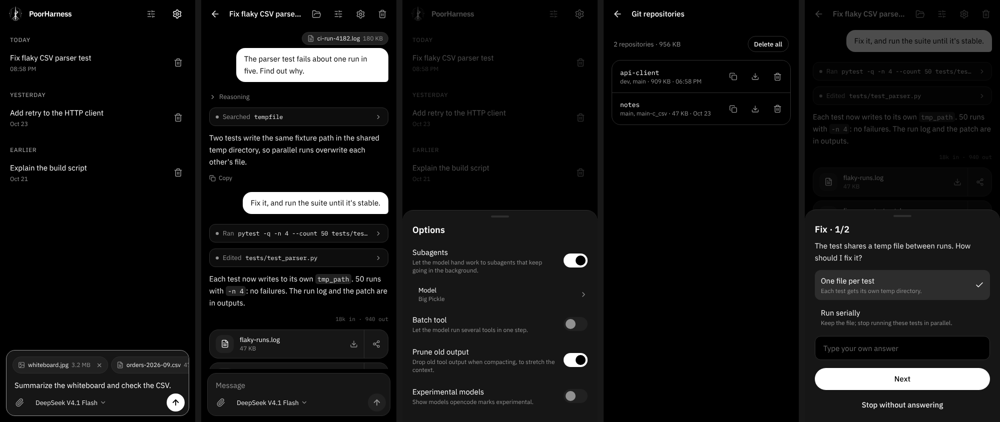

# PoorHarness

[日本語](README.ja.md)

A coding agent you drive from your Android phone. PoorHarness runs the official
[opencode](https://github.com/anomalyco/opencode) behind a chat interface, and
each chat works in a sandbox of its own: a [Tensorlake](https://www.tensorlake.ai)
cloud sandbox if you add a key, otherwise a confined folder on the phone (a
PRoot jail). Every model and provider in a chat uses the same sandbox, so you
can switch mid-chat and keep the files.  
*Note: The name “PoorDSH” appears in some places as a remnant of the fact that this was originally based on DeepSeekHarness, but there are no issues with its functionality.

There is no server of your own to run or pay for, and nothing is required to
start. Optional:

- **A Tensorlake API key** moves new chats into cloud sandboxes. The free plan
  works: one sandbox at a time, 1 vCPU, 1 GB of memory and 10 GB of disk.
- **For models, any of these:**
  - nothing: opencode uses OpenCode Zen's free models without an account;
  - an OpenCode Zen key, for paid models and higher limits;
  - an NVIDIA NIM key, for the models on NVIDIA's API;
  - an OrcaRouter key, for OrcaRouter's free models (only those are listed);
  - an Infron key, for Infron's free models (only those are listed);
  - a [Venice](https://venice.ai) key, for its paid models that Venice marks
    uncensored and private and that cost at most $0.35 in and $1.50 out per
    million tokens (five in October 2026: DeepSeek V4.1 Flash Uncensored, GLM 4.7
    Flash Heretic, Gemma 4 Uncensored, Venice Uncensored 1.2 and E2EE Gemma 4
    26B). The list follows Venice, and the picker shows each price. E2EE Gemma
    cannot call tools, so it is chat only, and the app does not encrypt on the
    client side.
- **An S3-compatible bucket** (AWS S3, Cloudflare R2, Backblaze B2, MinIO and
  the like) keeps the files agents hand over, and git repositories for them.

<p align="center"></p>

## Requirements

- Android 8.0 or newer, 64-bit ARM (arm64-v8a)
- About 800 MB of free storage: the APK is ~85 MB, Ubuntu unpacks to ~400 MB,
  and opencode downloads its sandbox tools (~200 MB) on its first start.

## How it works

```
 Phone                                       Tensorlake (with a key)
 +------------------------------------+      +-----------------------------+
 | WebView UI -- Kotlin host          |      | one sandbox per chat        |
 |               |- PRoot: Ubuntu     |      | /tmp/workspace              |
 |               |   `- opencode -----+----->| commands, files, search     |
 |               `- without a key:    |      +-----------------------------+
 |                  a PRoot jail per  |
 |                  chat, with its    |      S3-compatible bucket (optional)
 |                  /tmp/workspace    |      +-----------------------------+
 |                  and opencode's    |      | outputs/   git/             |
 |                  tools             |      +-----------------------------+
 +------------------------------------+
```

- A chat's sandbox is chosen with its first message: Tensorlake if a key is
  set, otherwise a jail on the phone. It does not change after that, even when
  you switch models.
- A Tensorlake sandbox is paused a minute after it was last used and deleted
  with the chat. A jail on the phone has its own home, temp and work folders in
  a copy of the app's Ubuntu, without the app's sign-ins or the phone's
  storage. Its programs are stopped a minute after it was last used (the files
  stay), and its folder is deleted with the chat.
- opencode itself runs on the phone in an Ubuntu userland started with PRoot
  (no root needed), because OpenCode Zen's free tier counts requests per IP
  address. Every tool it has that reads files or runs commands runs in the
  chat's sandbox through the official
  [tensorlake-opencode](https://github.com/tensorlakeai/opencode-tensorlake-plugin)
  plugin, which PoorHarness routes to the jail when there is no key. If those tools
  cannot be loaded, opencode does not run anything.
- Web pages and searches are fetched from the chat's sandbox, not from the phone
  (the sandbox needs python3). If the search service reports a usage limit, an
  optional [TinyFish](https://www.tinyfish.ai) key in Settings lets the app run
  the request there instead. The agent can hand work to subagents, which keep
  going in the background.
- When the agent needs a decision, it can ask you in the middle of its turn: a
  sheet shows its questions with choices, and you can type your own answer too.
- The sliders button in the header opens opencode's switches: subagents (on
  unless you turn them off) and features that are off by default, such as the
  batch tool. Under subagents you pick the model they run on, from any
  provider; by default they use the chat's model. The same sheet sets the
  chat title model (by default, the chat's model).
- The paperclip attaches files of any type; the only size limit is the free
  space in the chat's sandbox, checked when you pick a file. Files go into
  `/tmp/workspace/attachments`. Images, and PDFs for opencode models that
  support them, also go to the model directly.
- Settings → System prompt holds instructions every chat gets. A change
  applies from each chat's next message.
- Settings → Skills adds Agent Skills from a `.skill` or `.zip` made with
  Anthropic's skill-creator or for Claude Code; a copy is synced into each
  chat's sandbox before every message. Tap a skill to see its file tree and
  read any file.
- Settings → Plugins adds a plugin from a `.zip` or `.plugin` archive (Agent
  Plugins, Codex, Claude or Cursor format). opencode uses its skills, its MCP
  servers reached by URL and its agents; tap a plugin to see what is used.
- Files the agent puts in `/tmp/workspace/outputs` are handed to you when its
  turn ends and show under its reply: tap one to save it to
  Download/PoorHarness, or share it. They are kept on the phone, or under
  `outputs/` in the S3-compatible bucket you connect in Settings → Persistent
  storage. Several files, or a folder, arrive as one zip. Settings lists what
  is kept, to delete one file or all of them.
- With a bucket connected, agents get git repositories that live in it, under
  `git/`. The agent lists, opens or creates one with its repo tool; it becomes
  a bare repository at `/tmp/git/<name>.git` in the chat's sandbox to clone
  from and push to, and what it pushes is written back when its turn ends.
  Force pushes and branch deletions are refused, and a branch that moved on
  elsewhere is not overwritten: the chat's commits go to `<branch>-<chat id>`.
  The bucket key stays in the app. Settings → Git lists the repositories, to
  save the default branch as a git bundle or delete them.
- The repositories are stored the way
  [git-remote-s3](https://github.com/awslabs/git-remote-s3) stores a remote,
  so a computer can use them too. Copy a repository's address in Settings → Git
  and, with `pip install git-remote-s3` and the bucket's key in the usual
  `AWS_*` variables (plus `AWS_ENDPOINT_URL` for a provider other than AWS):
  `git clone s3://<bucket>/<folder>/git/<name>`. While the app saves, it waits
  for a push that git-remote-s3 has locked.
- The folder button in a chat shows its files. Save one to Download/PoorHarness or
  share it, or take the whole folder as a zip.
- Models, defaults and reasoning levels come from opencode at run time. New
  models show up without an app update.
- opencode is checked for updates each time the app opens, and can be updated
  from Settings; with Settings → Auto update on, newer releases are installed
  as they are found. Downloads are checked against the npm registry's
  integrity hashes. "Revert to default" goes back to the version this app
  ships with.

## Things to know

- **Agents act without asking by default.** They can change or delete anything
  in the chat's sandbox. Settings → Approvals switches to "Ask before commands"
  or "Ask every time".
- **A jail on the phone confines paths, not processes.** Its programs run as
  the app's Android user, so a program written to look could read the
  environment of the app's other processes, opencode's server password among
  them. All jails share the same Ubuntu, so a package installed in one chat is
  there in the others ("Reinstall Ubuntu" restores it). Use Tensorlake for work
  you do not trust.
- **Tensorlake may delete files after 7 days.** Save what you want to keep. A
  chat whose sandbox is gone continues in a new, empty one. A chat started in
  Tensorlake stays there; without the key it waits until you add it again.
- On Tensorlake's free plan only one cloud chat works at a time; starting
  another pauses sandboxes that are idle, and waits if the other chat is still
  working.
- Anonymous free models are rate-limited per IP address. On mobile networks
  that share addresses, adding a Zen key helps. Free models and their
  availability are set by OpenCode and can change.
- OrcaRouter's free tier allows few requests: for an account that has never
  paid, 50 a day across most free models, a few allow more (October 2026), and
  every step an agent takes is one. Once the day's allowance is spent, the chat
  waits and shows when it tries again; stop it to give up. Which models
  are free is OrcaRouter's choice; the list follows it at each engine start.
- Infron's free models share 1,000 requests a day per account, and Infron asks
  for a credit balance before an account may use them ($5 in October 2026;
  free use does not spend it). The list follows Infron the same way.
- A plugin's MCP servers that start as a command, its hooks and its commands
  (slash commands) are not used, and servers that need a sign-in do not
  connect.
- git-remote-s3 pushes only to storage that takes conditional writes, which
  it locks with (AWS S3 does). Backblaze B2 does not, so from a computer a B2
  bucket's repositories can be cloned and fetched, not pushed to.

## Build

Needs Linux x86_64 with JDK 21, Android SDK (platform 36, build-tools 36,
NDK 29), Node.js 20+, `proot`, `qemu-user-static`, `gawk`, `xz` and `curl`.

```sh
tools/build-apk.sh
# → android/app/build/outputs/apk/release/app-release.apk
```

The first run builds PRoot and the Ubuntu image (about 15 minutes); later runs
reuse them. Set `POORDSH_KEYSTORE`, `POORDSH_KEYSTORE_PASSWORD`,
`POORDSH_KEY_ALIAS` and `POORDSH_KEY_PASSWORD` to sign with your own key;
otherwise the debug key is used.

For UI work without a phone:

```sh
cd webui && npm install && npm run dev
```

A mock host stands in for the app (`?setup` shows first run, `?nokey` without
a Tensorlake key, `?nim` with an NVIDIA NIM key, `?orca` with an OrcaRouter
key, `?infron` with an Infron key, `?venice` with a Venice key, `?nos3` without a bucket, `?prompt` with a
system prompt, `?submodel` with a model for subagents, `?titlemodel` with a model for chat titles, `?ask` with questions
from the agent after a message, `?ratelimit` with a
message waiting for a daily limit, `?full` with attached files that do not
fit).

## Repository layout

| Path | Contents |
|---|---|
| `android/` | Kotlin host: runtime installer, PRoot launcher, opencode client, Tensorlake client, device jails, bucket and git storage, WebView bridge |
| `webui/` | React UI |
| `runtime/` | recipes for PRoot and the Ubuntu image, pinned versions and checksums |
| `tools/` | build script, icon generator |
| `docs/` | bridge protocol, design decisions, maintenance |

Design decisions are recorded in [`docs/adr/`](docs/adr/README.md), one file
per decision; [`docs/maintenance.md`](docs/maintenance.md) covers version bumps.

## License

MIT, see [LICENSE](LICENSE). Bundled third-party components keep their own
licenses, listed in [THIRD_PARTY_NOTICES.md](THIRD_PARTY_NOTICES.md).
